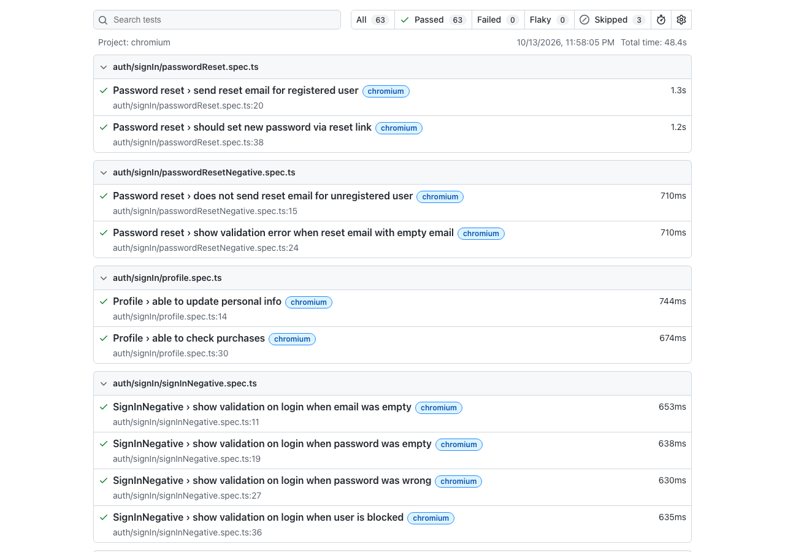

# Playwright E2E Test Automation — Demo Shop


End-to-end test automation framework for a demo e-commerce shop, built with Playwright and the Page Object Model. The suite has 66 tests covering authentication, catalog, cart, checkout and orders, and runs on every push in GitHub Actions.



## Tech stack

- [Playwright Test](https://playwright.dev/) — test runner, assertions, HTML report
- JavaScript / TypeScript
- Page Object Model
- [Faker](https://fakerjs.dev/) — generated test data
- GitHub Actions — CI

## What is covered

| Area | Tests | Scenarios |
|---|---|---|
| Sign in | 5 | valid login, empty email, empty password, wrong password, blocked user |
| Sign up | 6 | valid registration, empty fields, password mismatch, existing email, invalid email, short name |
| Password reset | 4 | reset email, new password via link, unregistered email, empty email |
| Profile | 2 | update personal info, open order history |
| Catalog | 14 | search, filters, sorting, product page, breadcrumbs |
| Cart | 6 | quantity, remove, clear, stock limit, reload, guest cart merge after login |
| Promo codes | 4 | valid, invalid, expired, below minimum order amount |
| Checkout | 9 | field validation, delivery methods, card payment, declined card, double click, confirmation page |
| Orders | 3 | new order in history, cancel order, stock decrease after purchase |
| Smoke | 9 | critical path, including guest and logged-in purchase end to end |
| Health | 4 | home page, products API, cart API, static assets |

Three of these tests are marked `test.fixme` because the shop does not have the feature yet (product variants, 3DS payment, order confirmation email). Each one has a comment explaining why.

## Project structure

```
src/pages/        page objects, one class per page
  signIn.js  signUp.js  passwordReset.js  account.js
  header.js  catalog.js  product.js
  cart.js  checkout.js  orders.js
tests/            specs, grouped by feature
  auth/  catalog/  cart/  checkout/  orders/  smoke/  health/
playwright.config.js
.github/workflows/playwright.yml
```

## How the tests are written

- **Page objects hold locators and actions.** Each class defines its locators in the constructor and exposes one method per user action, such as `enterEmail()` or `clickSubmitButton()`.
- **Specs hold scenarios and assertions.** A test reads as a list of steps followed by `expect` checks.
- **Every test starts from a clean state.** `beforeEach` resets the database through `POST /api/test/reset`.
- **Preconditions go through the API.** Filling the cart or logging in before the scenario under test is done with `page.request`, so the UI is exercised only where it matters.
- **Locators use `data-testid`.**

Example:

```ts
test('show validation on login when password was wrong', async ({ page }) => {
  await signInPage.enterEmail('user@shop.test');
  await signInPage.enterPassword('Password1234');
  await signInPage.clickSubmitButton();

  await expect(page.getByTestId('login-error')).toHaveText('Невірний email або пароль');
  await expect(page).toHaveURL('/login');
});
```

## How to run

Requires Node.js 18+.

```bash
npm install
npx playwright install chromium   # once
npm test                          # the shop server starts automatically
npm run test:ui                   # Playwright UI mode
npx playwright test --grep @smoke # smoke tests only
npx playwright show-report        # open the HTML report
```

## Continuous integration

[The workflow](.github/workflows/playwright.yml) runs the full suite on every push and pull request to `main`, and uploads the HTML report as an artifact.

## About the application under test

The shop is a small Node.js app (Express + EJS) that lives in this repository and exists for practising test automation: all data is fictional and the payment is simulated. Its interface is in Ukrainian, which is why expected texts in the assertions are Ukrainian.

Test users, promo codes, test cards, business rules and the JSON API are described in [docs/demo-shop.md](docs/demo-shop.md) (in Ukrainian).
